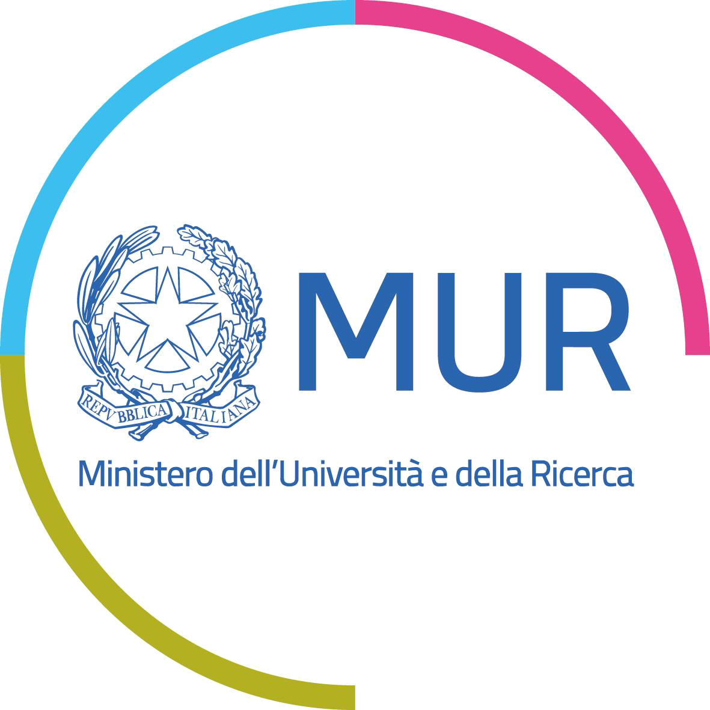
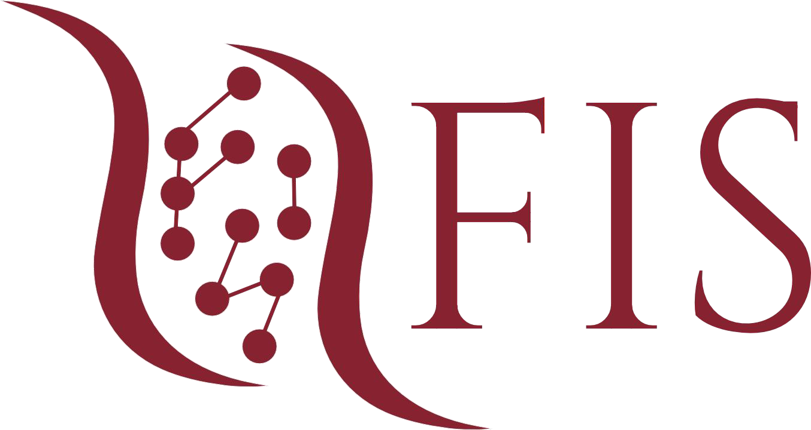

  

# HUmLrn

HUmLrn is a research project at Politecnico di Milano investigating how artificial intelligence agents can learn from different forms of human feedback within a unified framework.

Human guidance may be expressed through demonstrations, preferences, corrections, or evaluative signals. The project develops methodological foundations, theory, algorithms, software, and experimental benchmarks for integrating these heterogeneous feedback modalities into sequential decision-making.

## Research directions

- **Methodological:** formalize learning from diverse human feedback within a unified representation.
- **Theoretical:** characterize optimality, statistical complexity, and fundamental learning limits.
- **Algorithmic:** design principled and practical algorithms for heterogeneous feedback.
- **Experimental:** develop software interfaces, datasets, and benchmarks for evaluation.

## Software and datasets

Project repositories, experimental implementations, datasets, and benchmarks will be published in this organization as they become available.

## Project information

- **Institution:** Politecnico di Milano — Department of Electronics, Information and Bioengineering (DEIB)
- **Duration:** January 2026 — December 2028
- **Funding:** FIS 2 Starting Grant — Italian Science Fund, MUR
- **Principal Investigator:** Alberto Maria Metelli

## Acknowledgements

This project is funded by the **Ministero dell’Università e della Ricerca** through the **Fondo Italiano per la Scienza**.

**FIS-2023-02598/HUmLrn · CUP: D53C25000710001**

  
  &nbsp;&nbsp;&nbsp;&nbsp;
  
  &nbsp;&nbsp;&nbsp;&nbsp;
  

